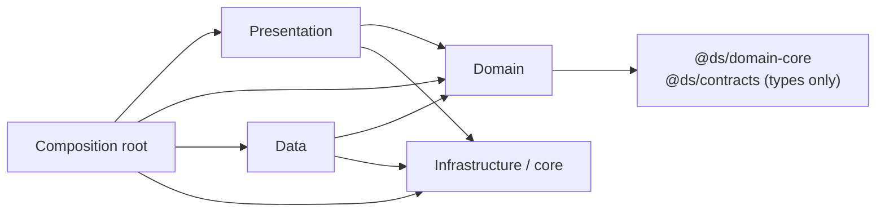

# Clean Architecture Rules

## 1. Layers and dependency direction

Dependencies point **inward** to the domain. The domain depends on nothing app-specific.

| Layer | Folder | May import | Must not import |
|---|---|---|---|
| Domain | `features/*/domain` | `@ds/domain-core`, `@ds/contracts` (types/schemas), other features' `domain` via their `index.ts` | `react`, `react-native`, `expo-*`, `@supabase/*`, `expo-sqlite`, UI libraries, `core/*` implementations |
| Data | `features/*/data` | domain of same feature, `core/*`, `@ds/contracts`, `@supabase/supabase-js` | `presentation`, `react-native` UI |
| Presentation | `features/*/presentation` | domain of same feature, `shared/*`, `core/errors`, `core/localization`, TanStack Query, Zustand | `features/*/data`, `@supabase/*`, `expo-sqlite`, `core/network` |
| Core (infrastructure) | `src/core` | external libraries | `features/*` |
| Shared (UI/platform-neutral helpers) | `src/shared` | `core`, UI kit | `features/*` |
| Composition | `src/app` | everything | — (nothing imports it except route files/providers) |

### Why `@ds/contracts` is allowed in domain
It contains plain types, Zod schemas and constants (error codes, feature keys) with no runtime platform
dependencies. Treat it as part of the domain vocabulary.

## 2. What goes where (decision guide)

| You are writing… | Put it in |
|---|---|
| "Line total = price × qty − discount" | `packages/domain-core` (shared, also mirrored in SQL) |
| "Udhaar needs a customer; warn above credit limit" | feature domain use case (client) **and** SQL function (authoritative) |
| "Call `create_sale` RPC with this payload" | feature data / remote data source |
| "Convert `SaleRecordDto` (snake_case) to `Sale`" | feature data / mappers |
| "Turn `DS_CREDIT_LIMIT_EXCEEDED` into a translated message" | `core/errors` (code → i18n key) |
| "Show red banner when offline" | presentation, using `connectivityStore` |
| "Format ₹1,23,456.00" | `shared/formatting` (wraps `domain-core` money) |
| "Read env var for Supabase URL" | `core/config` |
| "Is the shop allowed voice billing?" | `subscriptions` feature domain (`hasEntitlement`) reading resolved entitlements; server enforces |

## 3. Domain errors vs. application errors

- Domain errors are typed values (`{ kind: 'CreditLimitExceeded', limitPaise, balancePaise }`) returned or thrown by use cases.
- Data layer translates backend errors (Postgres codes, `DS_*` messages, network failures) into the same `AppError` shape.
- Presentation receives `AppError { code, messageKey, params, retryable, cause? }` only. Raw DB errors never reach the UI.

## 4. Enforcement

1. **ESLint `import/no-restricted-paths`** (or `eslint-plugin-boundaries`) zones implementing the table in §1.
   Lint runs in CI; violations fail the build.
2. **`no-restricted-imports`** in screen files: `@supabase/*`, `expo-sqlite`, `@tanstack/react-query`.
3. **TypeScript project references** for `packages/*` so domain-core cannot import React.
4. **Code review checklist** in PR template: "Does any screen/ViewModel access data except via a repository?"

## 5. Allowed exceptions (must be listed here)

| Exception | Where | Why |
|---|---|---|
| Auth session listener uses Supabase client directly | `core/security/SessionProvider` | Session lifecycle is infrastructure, not a feature repository |
| *(none else yet)* | | |
