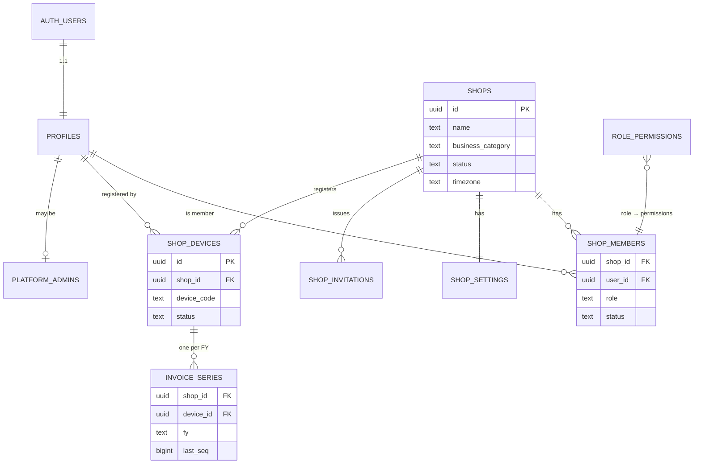
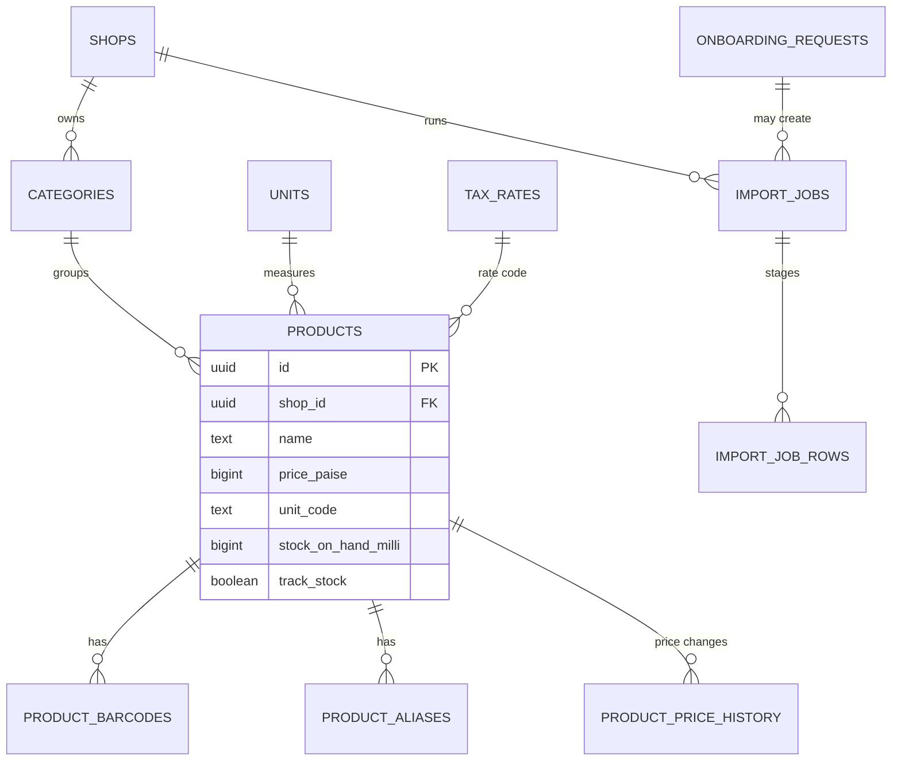
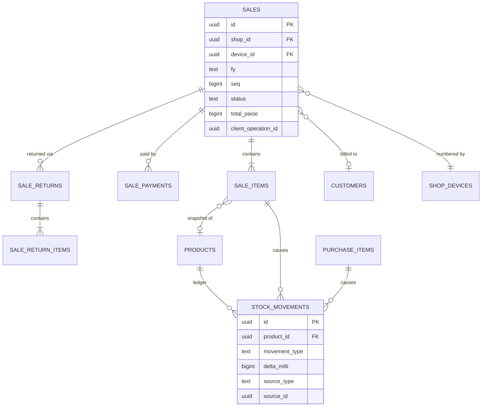
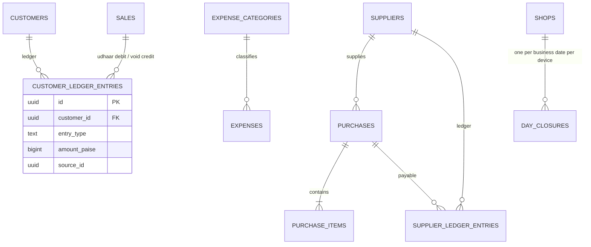
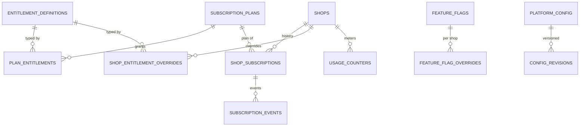
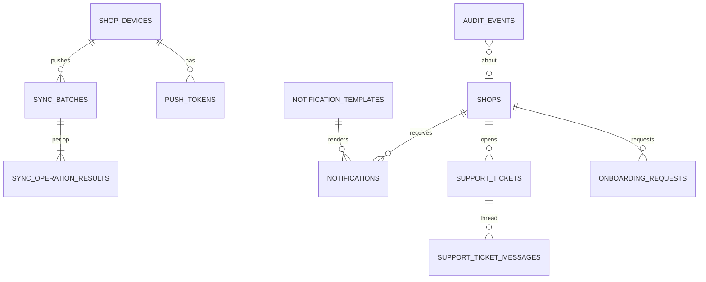

# Database ERD

Diagrams are split by domain. Every tenant table carries `shop_id` (omitted from relationship lines for readability).

## 1. Identity, tenancy, devices

## 2. Catalogue and imports

## 3. Sales, payments, stock

## 4. Customers, suppliers, purchases, expenses

## 5. Subscriptions, entitlements, feature flags, config

## 6. Operations: sync, notifications, support, audit

