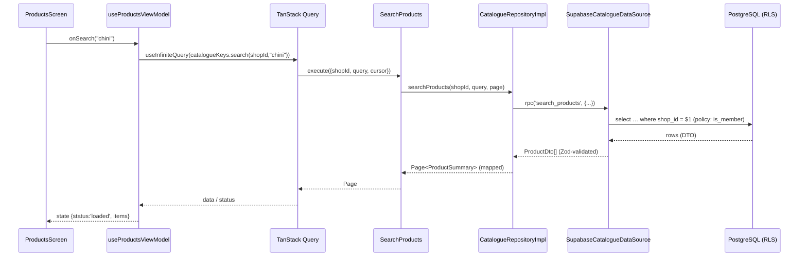
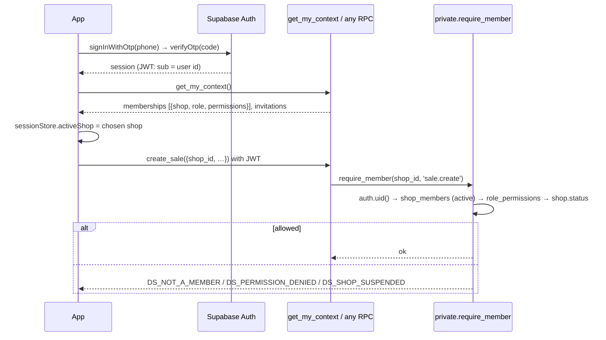
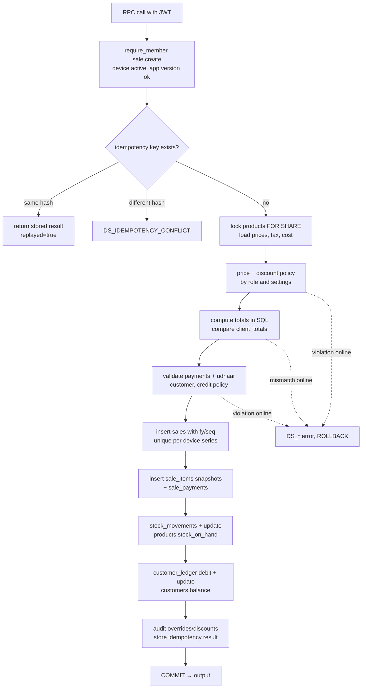
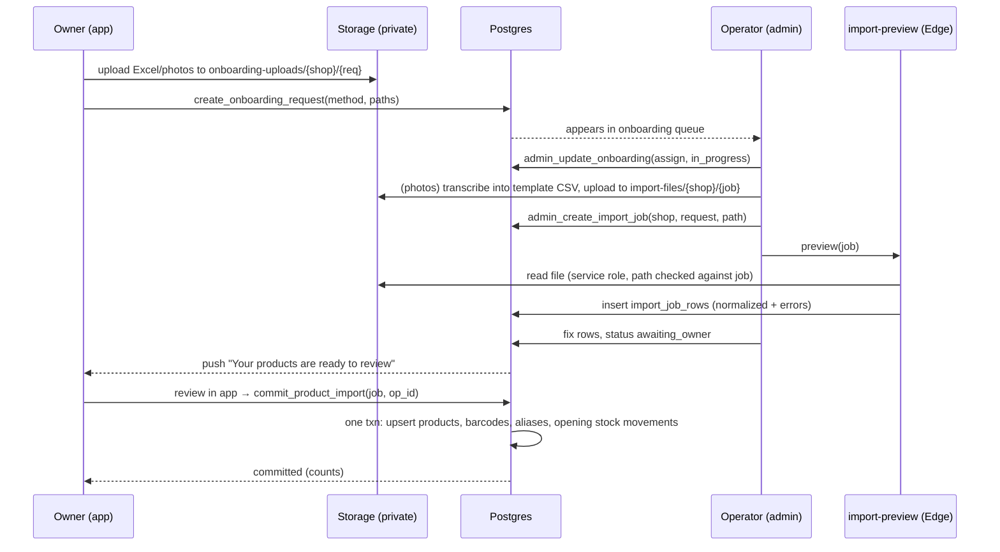

# Data Flow Diagrams

Diagrams must match the code. When a flow changes, update the diagram in the same PR.
Other diagrams: system architecture (SYSTEM_ARCHITECTURE.md §1), MVVM layers (MVVM_ARCHITECTURE.md §1),
offline write path (OFFLINE_SYNC_DESIGN.md §3), entitlement resolution and config refresh (FEATURE_CONFIGURATION.md §4, §7).

## 1. Repository / data-source flow (read with cache)



## 2. Authentication and tenant authorization



Role/permission are **looked up per request**, never read from JWT claims, so deactivation is immediate.

## 3. Sale creation transaction (`create_sale`)



For `origin = offline_sync`, policy violations in E/F/G become `needs_review` reasons instead of errors (ADR-012).

## 4. Managed onboarding



## 5. Subscription event processing (Phase 12)

```mermaid
sequenceDiagram
  participant P as Payment provider
  participant W as payments-webhook (Edge)
  participant DB as Postgres
  P->>W: POST event + signature
  W->>W: verify HMAC with webhook secret; reject if invalid
  W->>DB: process_verified_subscription_event(event) [service_role]
  DB->>DB: unique provider_event_id (replay-safe)<br/>update shop_subscriptions, audit
  DB-->>W: result
  W-->>P: 200
```
