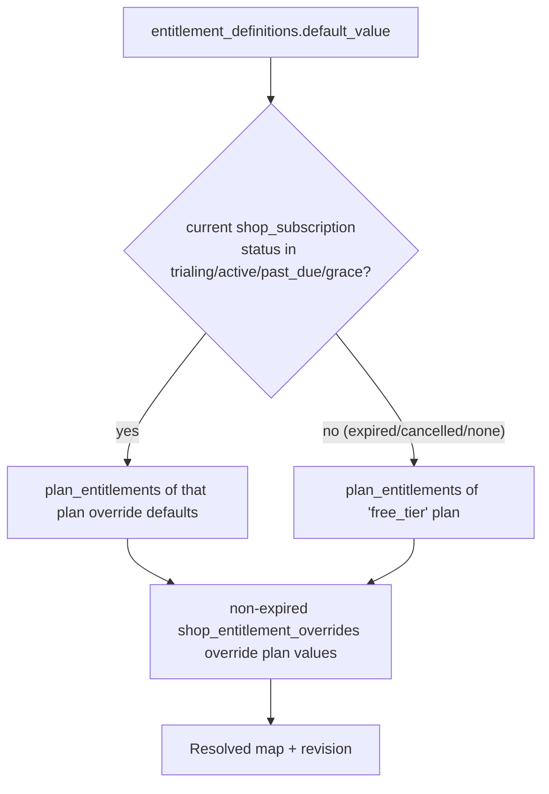

# Feature Configuration — Settings, Entitlements, Flags, Content

"Dynamic" here means **operational data the platform can change without an app release**, validated by
schemas, cached with safe defaults, audited. It does **not** mean remotely editable business logic or code.

## 1. Four kinds of configuration

| Kind | Who changes it | Stored in | Example | Enforced where |
|---|---|---|---|---|
| Shop settings | Shop owner | `shop_settings` | void window, UPI VPA, tax mode | RPCs read settings in-transaction |
| Platform config | super_admin | `platform_config` (+ `config_revisions`) | min app version, import max rows, maintenance banner, defaults | RPCs / Edge Functions; app for display |
| Entitlements | billing_admin via plans/overrides | `subscription_plans`, `plan_entitlements`, `shop_entitlement_overrides` | `products.max = 500` | `private.assert_entitlement` / quota checks |
| Feature flags | super_admin | `feature_flags`, `feature_flag_overrides` | `voice_billing` rollout 20 % | RPC checks for server features; app for UI |

Plus **dynamic content** (`content_blocks`, `announcements`, `notification_templates`): text only.

## 2. Flags vs entitlements

- **Entitlement** = commercial: "is this shop paying for it?" Always enforced server-side.
- **Feature flag** = operational: "is this feature ready/safe to run for this shop?" Used for rollout and kill switches.
- A feature is available when `entitlement allows AND flag enabled AND app version ≥ flag.min_app_version`.
- Flags never grant access an entitlement denies, and never bypass RLS.

## 3. Entitlement catalogue (initial)

Keys live in `packages/contracts/src/features.ts` and are seeded into `entitlement_definitions`.
Values below are **placeholders** until pricing is decided (OD-15).

| Key | Type | Safe default | free_trial | starter | pro | Enforced by |
|---|---|---|---|---|---|---|
| `products.max` | limit | 100 | 2000 | 500 | unlimited | trigger on `products` insert |
| `staff_accounts.max` | limit | 1 | 3 | 2 | 10 | `invite_shop_member`, `accept_shop_invitation` |
| `devices.max` | limit | 1 | 3 | 2 | 10 | `register_device` |
| `reports.advanced` | boolean | false | true | false | true | `get_sales_report` |
| `reports.export` | boolean | false | true | true | true | `export-report` |
| `exports.monthly` | limit | 0 | 20 | 10 | 100 | `export-report` via `usage_counters` |
| `catalogue.import` | boolean | true | true | true | true | `import-preview`, `commit_product_import` |
| `import.rows_per_job` | limit | 500 | 5000 | 2000 | 10000 | `import-preview` |
| `purchases.enabled` | boolean | false | true | true | true | `receive_purchase`, `create_supplier` |
| `offline.enabled` | boolean | true | true | true | true | `sync_push` |
| `voice.billing` | boolean | false | true | false | true | app gate; `voice-parse` if used |
| `onboarding.managed` | boolean | false | true | false | true | `create_onboarding_request` |
| `customers.max` | limit | 200 | unlimited | 1000 | unlimited | `create_customer` |

The **safe default** applies when a shop has no current subscription row or resolution fails — features
degrade, billing continues.

## 4. Resolution (server, `get_shop_entitlements` → `private.resolve_entitlements(shop_id)`)



`revision` = hash of (subscription row version, plan revision, override max(updated_at)) — lets the
client know when to refresh.

Enforcement helpers:
```sql
private.assert_entitlement(p_shop_id, 'reports.advanced');          -- raises DS_ENTITLEMENT_REQUIRED
private.assert_quota(p_shop_id, 'products.max', p_current_count);   -- raises DS_QUOTA_EXCEEDED (limit, used)
```

## 5. Feature flag evaluation (server, `private.flag_enabled(shop_id, key, app_version)`)

1. Unknown key → **false**.
2. Shop override exists and not expired → its value.
3. `enabled = false` → false.
4. `min_app_version` set and app older → false.
5. `rollout_percent < 100` → `abs(hashtext(shop_id::text || key)) % 100 < rollout_percent` (deterministic, stable per shop).
6. Otherwise true.

Kill switch = set `enabled=false` on a `kill_switchable` flag; propagates on next config refresh (≤ 15 min)
and immediately for server-checked features. **Billing itself is never behind a kill switch.**

Initial flags: `voice_billing`, `offline_sync`, `thermal_printing`, `barcode_continuous_scan`,
`whatsapp_receipt_share`, `udhaar_reminders`, `import_xlsx`.

## 6. Platform config keys (initial)

| Key | Schema (Zod in contracts) | Default bundled in app |
|---|---|---|
| `app.min_supported_version` | semver string | `0.0.0` |
| `app.latest_version` | semver | — |
| `maintenance` | `{ active, message: {en,hi}, blocks_writes }` | inactive |
| `import.max_file_mb` | int 1–20 | 5 |
| `defaults.shop_settings` | partial ShopSettings | as DB defaults |
| `business_categories` | `[{code, label:{en,hi}, suggested_categories[]}]` | bundled list |
| `support.contact` | `{ whatsapp, phone, hours }` | bundled |
| `config.refresh_seconds` | int 300–86400 | 900 |

## 7. Client caching and propagation

```mermaid
sequenceDiagram
  participant App
  participant Cache as SQLite/memory cache
  participant RPC as get_client_config / get_shop_entitlements
  App->>Cache: read last good config (or bundled defaults)
  App->>RPC: fetch on launch, on foreground, every refresh_seconds
  RPC-->>App: payload + revision
  App->>App: Zod-validate; unknown keys ignored
  alt valid
    App->>Cache: store as last good
  else invalid
    App->>App: keep last good, report DS_CONFIG_INVALID to Sentry
  end
```

- Already-installed apps pick up changes within `refresh_seconds` (default 15 min) or next foreground.
- Server-enforced items (entitlements, server-side flags) take effect **immediately** for writes regardless of client cache.
- Offline: cached entitlements/flags are used for UI; sync results may later report `DS_ENTITLEMENT_REQUIRED` for operations that need them (offline sales are never rejected for this — ADR-012).

## 8. Versioning, validation, rollback

- Every admin change goes through an `admin_*` RPC that validates value against the key's schema version,
  increments `revision`, copies the old value to `config_revisions`, writes `audit.events`.
- Rollback = admin "restore revision N" (creates a new revision with the old value).
- **Backward compatibility rule**: a config key's schema may only add optional fields. Breaking change =
  new key (`maintenance_v2`) and the app reads whichever it understands. Old apps keep working.
- App version gating: `min_supported_version` triggers a blocking "please update" screen; writes from older
  apps get `DS_APP_VERSION_UNSUPPORTED` (except `sync_push` of already-recorded sales, which is always accepted
  to avoid losing data — then the update screen is shown).

## 9. Dynamic navigation

`shared/navigation/moduleRegistry.ts` lists modules with `{ route, permission, entitlement?, flag? }`.
The tab bar and More menu render from it. Each route also uses `<RequireAccess …>` so deep links are guarded.
The server still enforces everything.

## 10. What is deliberately NOT dynamic

Money math, tax computation, invoice numbering, ledger rules, RLS policies, permission checks in RPCs,
screen layouts and code. These change through migrations and app releases with tests.
