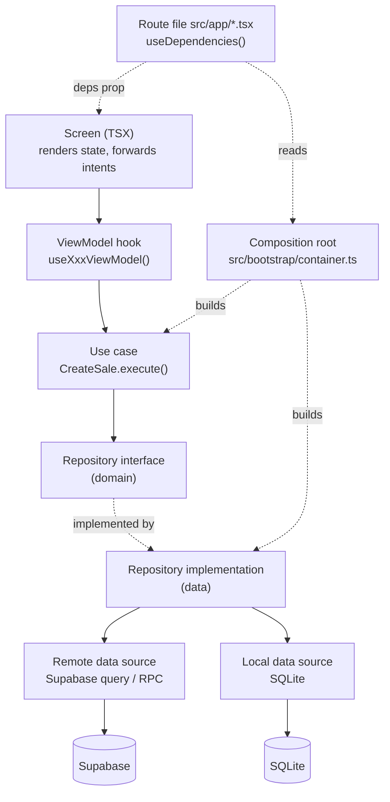

# MVVM Architecture — Mobile App

This document is the "how to write a feature" guide. If you are adding a screen, read this first.

## 1. The request flow



| Layer | Knows about | Must not know about |
|---|---|---|
| Screen | ViewModel's state + intents, shared components, router | Use cases, repositories, Supabase, SQLite |
| ViewModel | Use cases (via `useDependencies`), TanStack Query, Zustand stores, domain types | Supabase table names, SQL, HTTP, router (except returning "navigation events") |
| Use case | Repository interfaces, domain entities, `domain-core` | React, Expo, Supabase, SQLite |
| Repository impl | Data sources, mappers, error translation | React, screens |
| Data source | Supabase client / SQLite handle, DTOs | Domain entities, UI |

## 2. Feature folder template

```
src/features/billing/
├─ presentation/
│  ├─ screens/BillingScreen.tsx
│  ├─ components/AmountKeypad.tsx, BillLines.tsx, PaymentSheet.tsx
│  ├─ viewmodels/useBillingViewModel.ts
│  └─ state/billingState.ts            ← typed state + intents + pure reducer
├─ domain/
│  ├─ entities/Sale.ts, BillDraft.ts
│  ├─ repositories/BillingRepository.ts ← interface
│  ├─ usecases/CreateSale.ts, VoidSale.ts
│  └─ errors.ts                         ← feature-specific domain errors (if any)
├─ data/
│  ├─ datasources/remote/SupabaseBillingDataSource.ts
│  ├─ datasources/local/LocalBillingDataSource.ts   (Phase 09)
│  ├─ dto/CreateSaleRequestDto.ts, SaleRecordDto.ts  (types usually re-exported from @ds/contracts)
│  ├─ mappers/saleMapper.ts
│  └─ repositories/BillingRepositoryImpl.ts
├─ __tests__/                           ← co-located tests mirror the folders above
└─ index.ts                             ← only what other features may import
```

**Create only what the feature needs.** A read-only settings screen may have a screen + ViewModel +
repository, with no use-case class (the ViewModel calls the repository through a one-line use case
function, or directly through the repository interface — both are allowed; record which in the feature spec).
The non-negotiable rule: **no data access from screens or ViewModels except through a repository interface.**

## 3. ViewModel conventions

- Name: `use<Feature><Screen?>ViewModel`, file in `presentation/viewmodels/`.
- Returns `{ state, actions }` (or `{ state, ...actions }` when small). `state` is a typed, readonly object.
- Pure state transitions live in `state/<x>State.ts` as a reducer (`(state, event) => state`) so they are
  unit-testable without React.
- Async server data: `useQuery` / `useMutation` whose `queryFn` / `mutationFn` call **use cases**.
  Query keys come from a per-feature key factory (`billingKeys.history(shopId, filters)`).
- **Duplicate-submission guard**: every submit intent is a no-op while `status === 'submitting'`; the
  idempotency key is generated once per draft and reused on retry (see §6).
- Navigation: the ViewModel exposes outcomes (`state.completedSaleId`) or a one-shot `events` value; the
  **screen** decides to `router.push`. Keeps ViewModels router-free and testable.
- Cleanup: subscriptions (connectivity, realtime, timers) are created in `useEffect` with cleanup.
- One ViewModel per screen; shared logic between ViewModels goes into use cases or small shared hooks
  inside the feature, never into a "god" ViewModel.

### State model

Use a discriminated `status` plus data fields; don't build class hierarchies.

```ts
// features/billing/presentation/state/billingState.ts
export type BillingStatus =
  | 'editing'        // draft being built (initial)
  | 'submitting'     // create_sale in flight
  | 'completed'      // sale saved (online) — has saleId
  | 'queued'         // saved locally, waiting for sync (Phase 09)
  | 'error';         // last submit failed — has error

export interface BillingState {
  status: BillingStatus;
  draft: BillDraft;               // lines, discount, customer, payments
  totals: BillTotals;             // computed with domain-core, displayed live
  error?: AppError;               // from core/errors, has code + i18n key + retryable
  completedSaleId?: string;
}

export type BillingIntent =
  | { type: 'keypadAmountAdded'; amountPaise: Paise; label?: string }
  | { type: 'productAdded'; product: ProductSummary; quantityMilli: number }
  | { type: 'lineRemoved'; lineId: string }
  | { type: 'billDiscountChanged'; discountPaise: Paise }
  | { type: 'customerSelected'; customer: CustomerSummary | null }
  | { type: 'paymentsChanged'; payments: PaymentSplit[] }
  | { type: 'submitRequested' }
  | { type: 'resetRequested' };
```

### Example ViewModel shape

```ts
export function useBillingViewModel() {
  const { createSale } = useDependencies().billing;
  const session = useShopSession();                    // Zustand: shopId, deviceId, role, permissions
  const [state, dispatch] = useReducer(billingReducer, initialBillingState);

  const submit = useMutation({
    mutationFn: (draft: BillDraft) => createSale.execute({ session, draft }),
    retry: false,                                        // retries are explicit and reuse the same key
    onSuccess: (result) => dispatch({ type: 'submitSucceeded', result }),
    onError: (error) => dispatch({ type: 'submitFailed', error: toAppError(error) }),
  });

  const actions = {
    addAmount: (amountPaise: Paise, label?: string) => dispatch({ type: 'keypadAmountAdded', amountPaise, label }),
    submit: () => {
      if (state.status === 'submitting') return;          // duplicate guard
      dispatch({ type: 'submitRequested' });
      submit.mutate(state.draft);
    },
    // ...
  };
  return { state, actions };
}
```

(Illustrative; final signatures are fixed in Phase 04.)

## 4. Screens

- A screen file renders state and wires intents. Target < 150 lines; extract components when larger.
- No `supabase`, no `fetch`, no SQL, no `useQuery` in screen files (lint-enforced, see CLEAN_ARCHITECTURE.md §4).
- Every screen handles the five states in UI_FLOWS.md §5 using shared `<ScreenState>` components.
- Route files live in `src/app/` (Expo Router). They are thin: read the container, pass the feature's deps
  to its screen, and add route-level guards (`<RequirePermission permission="sale.create">`, Phase 02).

## 5. Dependency composition

Implemented in Phase 01 (ADR-019, ADR-020). Reference slice: `src/features/diagnostics`.

```ts
// src/bootstrap/container.ts
export function createContainer(env: AppEnv, storage = createChunkedSecureStorage()): Container {
  const supabase = env.backend ? createSupabaseClient(env.backend, storage) : null;   // core/network
  const diagnosticsRepository = new DiagnosticsRepositoryImpl(
    new AppInfoDataSource(env),
    env.backend ? new SupabaseHealthDataSource(env.backend) : null,
  );
  return { env, supabase, diagnostics: { getDiagnostics: new GetDiagnostics(diagnosticsRepository) } };
}
```

```tsx
// src/app/index.tsx — a route file: the only place that reads the container
export default function IndexRoute() {
  const { diagnostics } = useDependencies();
  return <DiagnosticsScreen deps={diagnostics} />;
}

// features/diagnostics/presentation/screens/DiagnosticsScreen.tsx
export function DiagnosticsScreen({ deps }: { deps: DiagnosticsViewModelDeps }) {
  const { state, actions } = useDiagnosticsViewModel(deps);
  // render state, forward intents
}
```

- `AppProviders` (src/bootstrap) builds the container once and puts it in React context.
- Only **route files** call `useDependencies()`; features never import `@/bootstrap`, so there is no cycle.
- Tests pass fakes straight into the screen or ViewModel (`deps={{ getDiagnostics: new GetDiagnostics(fakeRepo) }}`).
- ViewModels keep the latest deps in a ref so a caller passing new objects each render cannot trigger reload loops.
- No service locator lookups by string; the container is a typed object.

## 6. Idempotent submissions

1. When a draft is created, the ViewModel asks the use case for a `clientOperationId` (UUID v7).
2. Submit sends it. If the request times out or the network drops, state becomes `error` with `retryable: true`.
3. Retry re-sends **the same** `clientOperationId` and payload. The server returns the original result if it already committed.
4. Editing the draft after a failed submit generates a **new** `clientOperationId` (different payload = different operation).

## 7. Shared state (Zustand)

Allowed stores (keep this list short; add with a reason):

| Store | Holds | Persisted |
|---|---|---|
| `sessionStore` | user id, active shop id, device id, role, resolved permissions | Shop/device ids only (SecureStore) |
| `entitlementsStore` | resolved entitlements + revision + fetchedAt | SQLite cache (Phase 09), memory before |
| `connectivityStore` | online/offline, last change | No |
| `syncStore` | pending count, last sync, failures | Derived from SQLite (Phase 09) |

Server data (products, sales, customers) is **not** copied into Zustand; it lives in TanStack Query cache
(and SQLite for offline).

## 8. Testing each layer

| Layer | Test type | Tooling |
|---|---|---|
| `state/*` reducers | pure unit | Jest |
| Use cases | unit with fake repositories | Jest |
| ViewModels | hook tests with fake container | `@testing-library/react-native` `renderHook` |
| Screens | component tests for states + main interactions | RNTL |
| Repository impl | unit with fake data source; mapper + error mapping | Jest |
| Data sources | integration against local Supabase | Jest + local stack |

See TESTING_STRATEGY.md.

## 9. Admin panel equivalent

The admin app uses the same idea with Next.js idioms:
`page.tsx` (server component: auth guard, initial data via repository) → client component →
`useXxxViewModel` (TanStack Query + server actions) → server action → repository (server-only) → Supabase RPC.
Repositories in admin are server-only modules (`import 'server-only'`).
