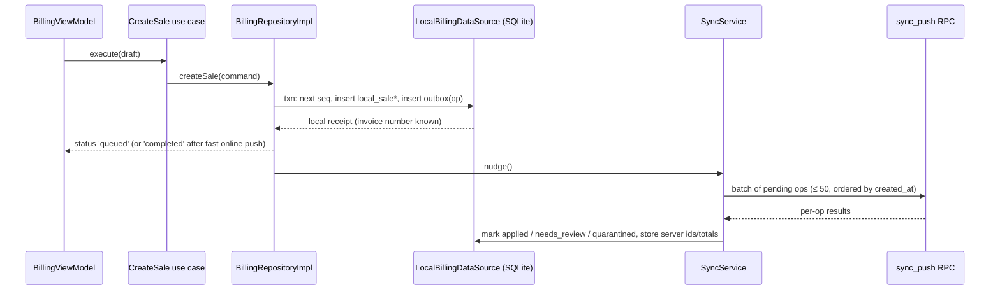

# Offline Sync Design (Phase 09)

Implemented only after online billing semantics (Phases 04–08) are stable. Online code is written now so
that offline is an additive change: client-generated ids, `client_operation_id`, device invoice series, and
RPCs that already accept `origin = 'offline_sync'`.

## 1. Scope (ADR-011)

| Works offline | Online only (v1) |
|---|---|
| Quick, itemised and mixed sales (incl. split payments and udhaar) | Product/category create/edit, imports |
| Customer quick-create | Voids, returns |
| Customer repayments | Purchases, stock adjustments |
| Expenses | Staff, settings, subscription |
| Reading: catalogue, customers + balances, today's own sales, settings, entitlements | Reports beyond local today summary |

## 2. Local database (SQLite)

| Table | Purpose |
|---|---|
| `meta` | schema version, shop id, device id, last pull cursors |
| `products_cache`, `barcodes_cache`, `aliases_cache`, `categories_cache` | Pulled catalogue (read-only locally) |
| `customers_cache` | Pulled customers + server balance + local pending delta |
| `settings_cache`, `config_cache`, `entitlements_cache` | Last good values with `fetched_at` |
| `invoice_counter` | `(fy, last_seq)` for this device — **source of truth for next seq** |
| `local_sales`, `local_sale_items`, `local_sale_payments` | Bills created on this device not yet acknowledged (and recent acknowledged ones for history) |
| `outbox` | `id, client_operation_id, operation, payload_json, status, attempts, last_error_code, created_at, next_attempt_at` |

All writes for one user action (sale + its outbox row + counter increment) happen in **one SQLite transaction**.

## 3. Write path

Online fast path: the repository writes locally first, then pushes immediately; if the push returns within
the timeout the UI shows `completed`. One code path for online and offline (no "two ways to create a sale").
Phase 09 decision (ADR-055): online bills still call `create_sale` directly; the outbox is used offline, when the
server gives no answer, or while earlier bills wait. Expenses stay online-only for now (ADR-059).

## 4. Sync protocol

`sync_push({ shop_id, device_id, app_version, operations: [{ client_operation_id, operation, payload }] })`

- Operations: `create_sale`, `create_customer`, `record_customer_repayment`, `record_expense`.
- Server processes each op **in its own savepoint** in order; one failure does not roll back the others.
- Per-op result: `applied` (with server result) · `replayed` (already applied, same hash) · `needs_review`
  (applied, flagged) · `quarantined` (not applied: authorization failure, e.g. member deactivated or device revoked) ·
  `retry` (transient, e.g. lock timeout).
- Dependencies: a sale referencing a locally-created customer is sent after that customer's op (ordering by
  `created_at`); if the customer op failed, the sale is held (`blocked`) locally and shown in Sync status.

`sync_pull({ shop_id, device_id, cursors: { products, customers, settings, ... } })`
- Returns rows with `updated_at > cursor` (keyset by `(updated_at, id)`), including tombstones (`archived_at`).
- Customer balances come from server; local pending repayments/udhaar shown as "pending" on top.

## 5. Retry, backoff, recovery

- Triggers: app start, foreground, connectivity regained, after each local write, every 60 s while pending > 0.
- Backoff: 5 s, 15 s, 60 s, 5 min, 15 min (max), jittered. Never drops an op automatically.
- Crash safety: outbox rows are durable; ops "in flight" when the app died are simply re-sent (idempotent).
- Quarantined ops are shown to the owner with the reason; resolution options: re-assign to current user
  (owner re-submits under their identity, audited) or mark as "recorded elsewhere" (kept locally, exported).

## 6. Conflicts

| Situation | Resolution |
|---|---|
| Price changed on server since cache | Sale accepted with device price; `needs_review: price_changed` unless matches history |
| Product archived on server | Accepted; `needs_review: product_archived` |
| Stock would go negative with `block` policy | Accepted (sale happened); `needs_review: negative_stock` |
| Credit limit exceeded with `block` policy | Accepted; `needs_review: credit_limit` |
| Same customer phone created on two devices | Server merges by `(shop_id, phone)`: second create returns existing id; client remaps local id (mapping table) before dependent ops |
| Invoice seq collision | Impossible by design (per-device series); if seen, device is forced to re-register → new device code |
| Clock skew | `occurred_at` outside window → accepted, `needs_review: clock_skew`; business_date from server receipt time if skew > 24 h |

Financial records are never overwritten; master-data edits are online-only in v1, so there are no merge conflicts on them.

## 7. Status UX

Header chip: `Synced` · `Offline · 7 waiting` · `Syncing…` · `Attention: 1` → Sync status screen listing
pending/failed/quarantined items with plain-language reasons and actions.

## 8. Tests

- Unit: outbox ordering, backoff schedule, id remapping, result handling.
- Integration (local Supabase): push same batch twice → replayed; mixed batch with one quarantined op;
  killed-mid-push simulation; pull with tombstones.
- E2E (Maestro): airplane mode billing → restore → verify counts on server.
