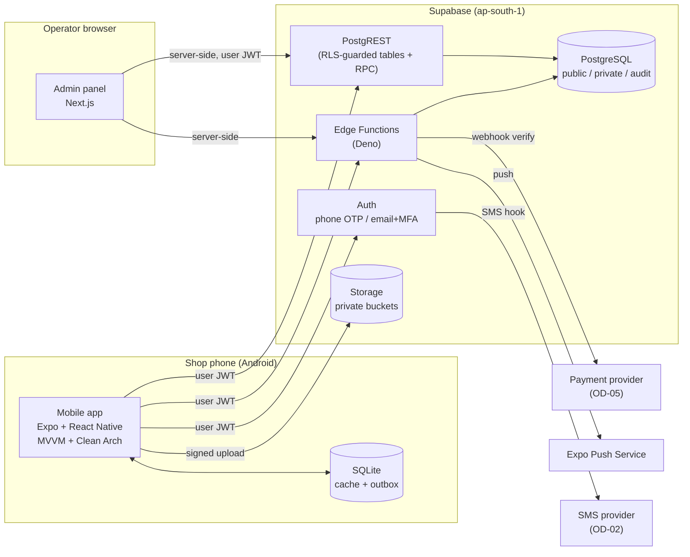

# System Architecture

## 1. Overview

Dukaan Saathi is a **modular monolith**: one PostgreSQL database (Supabase) holds all tenants, with
business logic split between typed client code (mobile/admin), PostgreSQL functions for atomic
business operations, and a small number of Edge Functions for trusted workflows that need secrets or
third-party calls. No microservices (ADR-003).



## 2. Repository layout (final for Phase 01)

Refined from the master prompt. Folders are created **when they get code**, not in advance.

```
dukaan-saathi/
├─ apps/
│  ├─ mobile/                      Expo app (SDK 58)
│  │  ├─ tests/                    shared test setup, fakes, renderWithProviders
│  │  └─ src/
│  │     ├─ app/                   Expo Router routes — thin files that pass deps to feature screens
│  │     │  ├─ (auth)/             login, otp                       (Phase 02)
│  │     │  ├─ (onboarding)/       create shop, pick language       (Phase 02)
│  │     │  └─ (shop)/             tabs + stacks for the active shop (Phase 02+)
│  │     ├─ bootstrap/             composition root: AppProviders, container, query client
│  │     ├─ core/                  platform services: config, errors, logging, network, storage,
│  │     │                         security, connectivity, localization, database (SQLite)
│  │     ├─ shared/                design system wrappers, generic hooks, formatting, theme
│  │     └─ features/<feature>/    presentation / domain / data (see MVVM_ARCHITECTURE.md)
│  └─ admin/                       Next.js App Router
│     ├─ app/                      routes (server components by default)
│     └─ src/
│        ├─ core/                  supabase server client, auth guard, logging, errors
│        ├─ shared/                UI kit (shadcn/ui), table, form helpers
│        └─ features/<module>/     presentation (components + view-model hooks) / domain / data
├─ packages/
│  ├─ contracts/                   Zod schemas + TS types for every RPC/Edge payload, error codes,
│  │                               entitlement & feature keys, generated DB types
│  └─ domain-core/                 Pure TS: money, quantity, tax, invoice-number, ledger and
│                                  entitlement-resolution functions shared by mobile, admin and tests
├─ supabase/
│  ├─ config.toml
│  ├─ migrations/                  ordered SQL migrations (only source of schema truth)
│  ├─ functions/                   Edge Functions (Deno), each folder = one function
│  │  └─ _shared/                  shared Deno helpers (auth, errors, validation adapters)
│  ├─ seed/                        dev seed (fake shops, products) — never production
│  └─ tests/                       pgTAP tests: RLS, RPC transactions, privileges
├─ docs/
└─ .github/workflows/              CI
```

### Refinements vs. the master prompt (documented deviations)

| Prompt proposal | Decision | Reason |
|---|---|---|
| `packages/validation`, `packages/domain-types`, `packages/configuration` | Merged into `packages/contracts` | They change together (a schema, its type, its error codes, the feature keys it checks). Three packages would mean three version bumps for one change. Split later if it grows. |
| Domain entities only inside each mobile feature | Shared pure calculation logic lives in `packages/domain-core`; feature-specific entities stay in features | Money/tax/ledger math must be identical in mobile, admin, and tests; Postgres re-implements it and is tested against the same fixtures. |
| `features/<x>/index.ts` everywhere | Only where another feature needs something (public API of a feature) | Avoid barrel files that create import cycles. |
| `apps/mobile/src/app/composition` | `src/bootstrap/container.ts` | `src/app` is Expo Router's routes folder in SDK 58 (ADR-019). Simple explicit DI (ADR-006). |
| `supabase/seed/` | Seed files go in `supabase/seed/*.sql` (config.toml `sql_paths`) | Phase 01 has no seed data yet. |
| Separate `scripts/` folder | `scripts/db-check-pglite.mjs` | Local DB pre-check without Docker (ADR-024). |

## 3. Runtime responsibilities

| Concern | Where it lives | Why |
|---|---|---|
| Rendering, input, navigation | Mobile screens / admin pages | Presentation only |
| Screen state, user intents | ViewModels (`useXxxViewModel`) | Testable without rendering |
| Business rules (client side) | Domain use cases + `domain-core` | Fast feedback, offline operation |
| Authoritative business rules | PostgreSQL functions (RPC) | Atomic, cannot be bypassed |
| Simple CRUD (products, categories, suppliers) | PostgREST table access under RLS + triggers | No reason to hand-write RPC for each table (ADR-005) |
| Secrets, third-party APIs, file parsing, webhooks | Edge Functions | Need secrets / heavier libraries / service role |
| Scheduled jobs | `pg_cron` → SQL or Edge Function | Daily digests, subscription expiry, cleanup |
| Offline storage | SQLite (`expo-sqlite`) via local data sources | Survives restarts; queryable |
| Session tokens | `expo-secure-store` (encrypted-key scheme, see SECURITY_MODEL.md §6) | Secrets not in plain AsyncStorage |

## 4. Technology choices

Exact versions are pinned in Phase 01 after compatibility checks (`npx expo install --check`,
peer-dependency review). This table records the **choice**, not a version.

| Area | Choice | Notes |
|---|---|---|
| Package manager / monorepo | npm workspaces (+ Turborepo for task caching, optional) | npm is installed; Expo supports npm workspaces natively; pnpm would need hoisting config. ADR-002 |
| Mobile framework | Expo (latest stable SDK at Phase 01), React Native New Architecture, TypeScript strict | Development builds (not Expo Go) once native modules are needed |
| Routing | Expo Router | Typed routes enabled |
| Server state | TanStack Query | Used inside ViewModels only |
| Client state | Zustand | Active shop session, bill draft, sync status; nothing that belongs to the server |
| Forms | React Hook Form + Zod (schemas from `contracts` where they match) | |
| UI kit | React Native Paper (Material 3), wrapped in `shared/components` | Accessible, maintained, theming; wrapping keeps it replaceable. OD-09 |
| Local DB | `expo-sqlite` with hand-written migrations | Drizzle ORM considered; decision at Phase 09 (OD-11) |
| Secure storage | `expo-secure-store` | |
| Barcode | `expo-camera` (`CameraView` barcode scanning) | `expo-barcode-scanner` is deprecated |
| Sharing / PDF | `expo-print`, `expo-sharing`, WhatsApp deep links | |
| Speech | On-device recognition via an Expo-compatible module (candidate: `expo-speech-recognition`) | Verified in Phase 10 spike |
| Push | `expo-notifications` + Expo Push Service | |
| i18n | `i18next` + `react-i18next` + `expo-localization` | |
| Unit tests | Jest (`jest-expo` preset) + React Native Testing Library | |
| Mobile E2E | Maestro | Works with Expo dev builds; Detox is heavier to maintain |
| Admin | Next.js (App Router), shadcn/ui + Tailwind, TanStack Query (client islands), Zod | |
| Admin tests | Vitest + Testing Library; Playwright for E2E | |
| DB tests | pgTAP via `supabase test db` | Needs Docker locally (not installed — OD-13) |
| Monitoring | Sentry (mobile + admin + edge) | Credentials required |
| CI | GitHub Actions | |
| Build/release | EAS Build, EAS Submit, EAS Update (OTA, runtime-version gated) | |

## 5. Environments

| Env | Supabase | Mobile | Admin |
|---|---|---|---|
| local | `supabase start` (Docker) or a dedicated dev cloud project | dev build on device/emulator | `next dev` |
| staging | separate Supabase project | EAS `preview` channel | staging deployment |
| production | separate Supabase project, Mumbai, PITR enabled | EAS `production` channel, Play Store | production deployment |

Never share a database between staging and production. Never put a service-role key in any client bundle.

## 6. Cross-cutting conventions

- **IDs**: UUID v7 generated by the client for entities created offline (`sales`, `customers`, `expenses`) so
  they are time-ordered and known before sync; server-default `gen_random_uuid()` elsewhere.
- **Timestamps**: `timestamptz` in UTC; display in shop time zone.
- **Naming**: SQL `snake_case`; TypeScript `camelCase`; mappers convert. RPC names are verbs: `create_sale`.
- **Errors**: one error-code catalogue in `packages/contracts/src/errors.ts`, mirrored in SQL (`DS_*`). See API_AND_RPC_CONTRACTS.md §2.
- **Feature keys**: one catalogue in `packages/contracts/src/features.ts`, seeded into `entitlement_definitions`. See FEATURE_CONFIGURATION.md.
