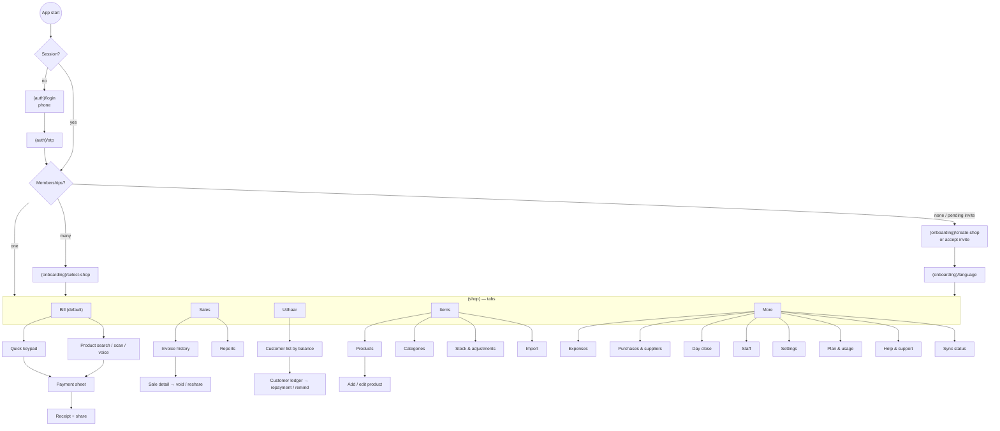

# UI Flows — Mobile App

## 1. Design principles

1. **Bill first.** The billing screen is the default tab and opens in one tap from anywhere.
2. **Big, few, clear.** Large keypad, ≥ 48 dp targets, one primary action per screen, Hindi labels fit without truncation.
3. **Always say the state.** Every screen shows loading / empty / error / offline-pending explicitly.
4. **Undo over confirm** for cheap actions (remove line); **confirm** for money-moving or irreversible actions (void, udhaar adjustment).
5. **Hidden ≠ forbidden.** Navigation hides what a role or plan cannot use, but every route also guards itself (route guard + server check).

## 2. Navigation map

Tab visibility depends on role permissions and entitlements (see AUTHORIZATION_MATRIX.md); a cashier sees
Bill, Sales (own sales only), Udhaar (record repayment only if permitted), More (limited).

## 3. Screen inventory

| Route (Expo Router) | Screen | ViewModel | Phase |
|---|---|---|---|
| `(auth)/login` | `LoginScreen` | `useLoginViewModel` | 02 |
| `(auth)/otp` | `OtpScreen` | `useOtpViewModel` | 02 |
| `(onboarding)/create-shop` | `CreateShopScreen` | `useCreateShopViewModel` | 02 |
| `(onboarding)/select-shop` | `SelectShopScreen` | `useSelectShopViewModel` | 02 |
| `(onboarding)/language` | `LanguageScreen` | `useLanguageViewModel` | 02 |
| `(shop)/(tabs)/bill` | `BillingScreen` | `useBillingViewModel` | 04 |
| `(shop)/bill/payment` (sheet) | `PaymentSheet` | part of `useBillingViewModel` | 04 |
| `(shop)/bill/receipt/[saleId]` | `ReceiptScreen` | `useReceiptViewModel` | 04 |
| `(shop)/bill/scan` | `ScanScreen` | `useScanViewModel` | 05 |
| `(shop)/bill/voice` | `VoiceBillingScreen` | `useVoiceBillingViewModel` | 10 |
| `(shop)/(tabs)/sales` | `SalesHistoryScreen` | `useSalesHistoryViewModel` | 05 |
| `(shop)/sales/[saleId]` | `SaleDetailScreen` | `useSaleDetailViewModel` | 05 |
| `(shop)/reports` | `ReportsScreen` | `useReportsViewModel` | 06 |
| `(shop)/dashboard` (opened from the Sales tab header; owner/manager) | `DashboardScreen` | `useDashboardViewModel` | 06 |
| `(shop)/expenses` / `new` | `ExpensesScreen`, `ExpenseFormScreen` | `useExpensesViewModel`, `useExpenseFormViewModel` | 06 |
| `(shop)/day-close` | `DayCloseScreen` | `useDayCloseViewModel` | 06 |
| `(shop)/(tabs)/items` | `ProductsScreen` | `useProductsViewModel` | 03 |
| `(shop)/items/[productId]` / `new` | `ProductFormScreen` | `useProductFormViewModel` | 03 |
| `(shop)/items/categories` | `CategoriesScreen` | `useCategoriesViewModel` | 03 |
| `(shop)/items/import` | `ImportScreen`, `ImportReviewScreen` | `useImportViewModel` | 03 |
| `(shop)/stock` / `adjust` / `count` | `StockScreen`, `StockAdjustScreen`, `StockCountScreen` | `useStockViewModel`, `useStockAdjustViewModel`, `useStockCountViewModel` | 07 |
| `(shop)/suppliers`, `purchases/new` | `SuppliersScreen`, `PurchaseFormScreen` | `useSuppliersViewModel`, `usePurchaseFormViewModel` | 07 |
| `(shop)/(tabs)/udhaar` | `UdhaarListScreen` | `useUdhaarListViewModel` | 08 |
| `(shop)/customers/[customerId]` | `CustomerLedgerScreen` | `useCustomerLedgerViewModel` | 08 |
| `(shop)/customers/[customerId]/repay` | `RepaymentSheet` | `useRepaymentViewModel` | 08 |
| `(shop)/sync` | `SyncStatusScreen` | `useSyncStatusViewModel` | 09 |
| `(shop)/staff` | `StaffScreen` | `useStaffViewModel` | 02 |
| `(shop)/settings/*` | `SettingsScreen` + sections | `useShopSettingsViewModel` | 02+ |
| `(shop)/plan` | `PlanScreen` | `usePlanViewModel` | 12 |
| `(shop)/onboarding-request` | `OnboardingRequestScreen` | `useOnboardingRequestViewModel` | 11 |
| `(shop)/support` / `[ticketId]` | `SupportScreen`, `TicketScreen` | `useSupportViewModel`, `useTicketViewModel` | 11 |

## 4. Key journeys

### J-01 First bill in under two minutes (new owner)
Login with phone → OTP → create shop (name, category, language) → land on Bill keypad → type `120` → `+` →
type `40` → **Cash** → receipt → share on WhatsApp.

### J-02 Itemised bill with scanner and udhaar
Bill → scan two items → search "chini" → pick "Cheeni 1 kg", qty 2 → Pay → choose customer "Ramesh" →
split: ₹200 cash + rest udhaar → credit-limit warning shown → confirm → receipt shows "Balance due ₹1,340".

### J-03 Repayment
Udhaar tab → Ramesh (₹1,340) → Record payment ₹500 UPI → ledger shows new balance ₹840 → share confirmation.

### J-04 Void
Sales → bill #B-000123 → Void → reason "wrong item" → confirm → stock and udhaar reversed → bill shows VOIDED.

### J-05 Offline day
Network off → bills continue (banner "Offline · 7 bills waiting") → network back → sync → banner clears;
one bill flagged "needs review: price changed" visible to owner in Sync status.

### J-06 Voice bill
Bill → mic → "do kilo aata, ek Surf Excel, pachaas rupaye ki dhaniya" → draft lines with confidence →
fix one ambiguous match → confirm → payment sheet.

## 5. States every screen must render

`loading` (skeletons, not spinners, for lists) · `empty` (with the next action) · `error` (message from
error catalogue + retry when retryable) · `offline` (cached data with "as of" time, writes queued or
disabled with explanation) · `forbidden` (role/plan — explains and links to plan screen where relevant).
