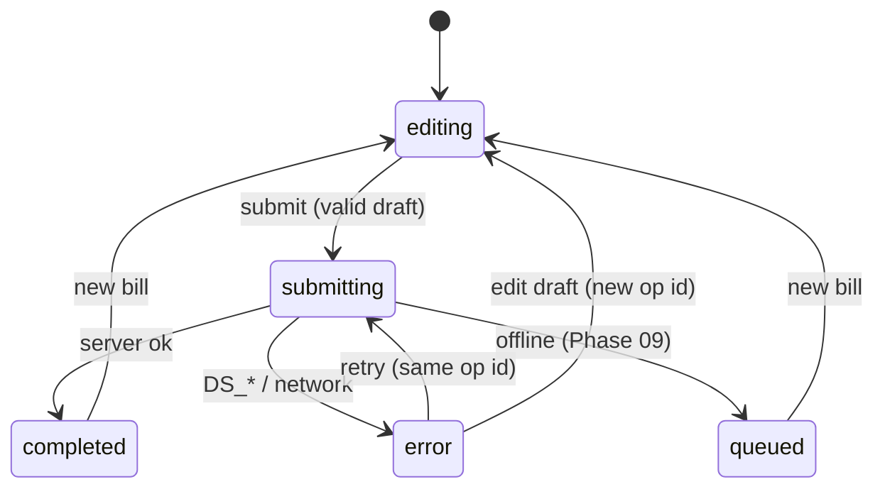

# Feature: Billing (Quick, Product, Barcode), Payments, Receipts, Voids

Status: Planned · Phase: 04 (quick + payments + receipt), 05 (product, barcode, history, void), 06 (returns) ·
Requirements: FR-03, FR-05, FR-06, FR-07, FR-08

## Purpose
The core of the product: create a correct, atomic, idempotent bill in seconds, record how it was paid, and
give the customer a receipt.

## Screens and ViewModels
| Screen | ViewModel | State model |
|---|---|---|
| BillingScreen (keypad + lines + search entry) | useBillingViewModel | `editing / submitting / completed / queued / error` (MVVM_ARCHITECTURE.md §3) |
| PaymentSheet | useBillingViewModel | payment split editor, cash tendered → change due |
| ScanScreen | useScanViewModel | `requestingPermission / scanning / matched / unknownCode / denied` |
| ReceiptScreen | useReceiptViewModel | `loading / loaded / sharing / error` |
| SalesHistoryScreen | useSalesHistoryViewModel | filters, infinite list |
| SaleDetailScreen | useSaleDetailViewModel | `loaded / voiding / voided / error` |

## User actions
addAmount(paise, label) · addProduct(product, qty | amount) · changeQuantity · removeLine (undo) · setLineDiscount ·
overridePrice · setBillDiscount · selectCustomer / quickAddCustomer · setPayments(split) · setCashTendered · submit ·
retrySubmit · newBill · share(pdf|image|whatsappText) · voidSale(reason) · filterHistory.

## Domain
- `BillDraft` entity: lines, discounts, customer, payments; invariants checked by `domain-core`:
  totals (BR-03..05), Σ payments + udhaar = total (BR-07), udhaar ⇒ customer (BR-08), discount ≤ role limit (BR-13).
- Amount-based loose entry: qty_milli = floor(amount_paise × 1000 / price_paise); the line amount is then recomputed
  from qty (may differ by < 1 paisa → shown; shopkeeper may round the qty).
- `InvoiceNumber` value object: format/parse `{prefix}/{fy}/{device}-{seq}`; `financialYear(date, tz)`.

## Use cases
`CreateSale` (assigns invoice seq from device counter, generates client ids, validates draft, calls repo),
`VoidSale`, `GetSale`, `ListSales`, `BuildReceipt` (pure: sale → receipt view model incl. localized labels and tax split),
`ShareReceipt` (via `core/sharing` port), `FindProductByBarcode` (delegates to CatalogueRepository).

## Repository interface
`BillingRepository`: `createSale(command)`, `voidSale(command)`, `getSale(shopId, saleId)`, `listSales(shopId, filter, page)`.
Device invoice counter: `InvoiceCounterStore` port (SecureStore in Phase 04, SQLite from Phase 09).

## Data sources
| Data source | Calls |
|---|---|
| SupabaseBillingDataSource | `rpc create_sale`, `rpc void_sale`, `rpc get_sale`, `rpc list_sales` |
| LocalBillingDataSource (Phase 09) | `local_sales*`, `outbox` |
| ReceiptRenderer (core/sharing) | `expo-print` HTML→PDF, `expo-sharing`, WhatsApp `whatsapp://send?text=` |

## Database
Tables: `invoice_series`, `sales`, `sale_items`, `sale_payments`, `stock_movements`, `customer_ledger_entries` (Phase 08 creates
customers; Phase 04 allows udhaar only after customers exist — udhaar payment method is hidden until Phase 08 ships), `private.idempotency_keys`.
RPCs: `create_sale`, `void_sale`, `get_sale`, `list_sales`, later `create_sale_return`. Contract: API_AND_RPC_CONTRACTS.md §5.1–5.2.

## State transitions

## Validation
| Rule | Client | Server |
|---|---|---|
| ≥ 1 line, ≤ 200 lines | domain | RPC |
| amounts > 0, integers | domain | RPC + checks |
| totals match | domain-core | SQL recompute (`DS_TOTAL_MISMATCH`) |
| payment methods enabled in settings | UI | RPC |
| udhaar ⇒ customer | domain | RPC |
| discount within role limit | domain (from session permissions + settings) | RPC |

## Errors
| Code | UI |
|---|---|
| `DS_TOTAL_MISMATCH` | "Prices changed — refreshing" → refetch products, keep draft, re-show totals |
| `DS_PRODUCT_INACTIVE` | mark line, offer quick-line conversion |
| `DS_INSUFFICIENT_STOCK` | show stock, owner can change policy |
| `DS_CREDIT_LIMIT_EXCEEDED` | show limit/balance; owner override path = reduce udhaar |
| `DS_DISCOUNT_LIMIT_EXCEEDED` / `DS_PRICE_OVERRIDE_DENIED` | inline on line |
| `NETWORK_*` | keep draft, "Retry" (same op id) |
| `DS_IDEMPOTENCY_CONFLICT` | should not happen; log + new op id after user confirms |

## UPI
Static QR (`upi://pay?pa=<vpa>&pn=<shop>&am=<amount>&cu=INR&tn=<invoice>`), rendered with a QR library. Cashier
taps "Received" → payment recorded with `confirmation = 'manual'`. Receipt says "UPI (confirmed by shop)". No verification claim.

## Authorization
`sale.create` (all roles), `sale.discount`/`sale.price_override` (limits), `udhaar.grant`, `sale.void` (owner any time;
manager within window), cashier history scope per `cashier_sees_all_sales`.

## Tests
domain-core money fixtures (shared with pgTAP) · reducer transitions · ViewModel: duplicate submit, retry same id, edit → new id ·
pgTAP: §5.1 test list · void reversal correctness · receipt builder snapshot tests (en/hi, GST/non-GST) · Maestro J-01, J-02, J-04.

## Acceptance criteria
- [ ] Quick bill: ≤ 3 taps after amount; saved once even with double-tap and network retry.
- [ ] Mixed bill with discount and split payment: server totals equal client totals for all fixtures.
- [ ] Receipt shares as PDF and WhatsApp text in Hindi and English.
- [ ] Void restores stock and udhaar; voided bill visible with reason; no rows deleted.
- [ ] Cashier cannot exceed discount limit even via direct RPC call.

## Limitations
Thermal printing pending OD-08. No payment-provider UPI verification. No held/parked bills in v1 (backlog BL-B07).
