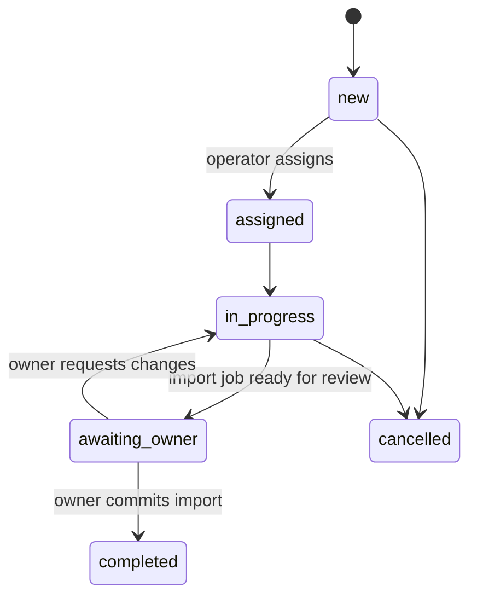

# Feature: Managed Onboarding and Support

Status: Planned · Phase: 11 · Requirements: FR-16, FR-17 (operator side), FR-24

## Purpose
Remove the biggest adoption barrier (typing in 500 products) by letting our operators do it, and give shops a way to get help.

## Mobile
| Screen | ViewModel |
|---|---|
| OnboardingRequestScreen (choose method, attach files/photos, contact time) | useOnboardingRequestViewModel |
| OnboardingStatusCard (on Items tab) | useOnboardingStatusViewModel |
| ImportReviewScreen (reused from catalogue) for owner approval | useImportViewModel |
| HelpScreen (dynamic content), SupportScreen (tickets), TicketScreen (thread) | useHelpViewModel, useSupportViewModel, useTicketViewModel |

Repositories: `OnboardingRepository` (`rpc create_onboarding_request`, storage upload, status select), `SupportRepository`
(`rpc create_support_ticket`, `rpc add_ticket_message`, selects with RLS hiding internal notes), `ConfigRepository` (help content).

## Admin
Onboarding queue, import job workbench, support queue — see ADMIN_PANEL_SPECIFICATION.md §2.

## Onboarding state machine

## Rules
- Files go only to private buckets; operators read via short-lived signed URLs.
- Owner approval is required to commit an import into their catalogue (consent), unless the owner ticked "operator may commit" on the request (stored, audited).
- Support internal notes (`is_internal`) never visible to the shop (RLS).

## Entitlement
`onboarding.managed`.

## Acceptance criteria
- [ ] Owner submits request with photos; operator sees it, builds import, owner reviews and commits in app.
- [ ] Operator without onboarding role cannot see attachments.
- [ ] Ticket replies from admin appear in app; internal notes do not.
