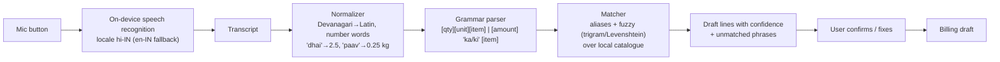

# Feature: Hindi/Hinglish Voice Billing

Status: Implemented (Phase 10, see [../phases/PHASE_10_VOICE.md](../phases/PHASE_10_VOICE.md)) · Phase: 10 · Requirements: FR-19

## Purpose
Let a shopkeeper speak a list of items and get a **draft** bill to confirm — faster than typing for long lists.

## Pipeline

All parsing and matching is **pure TypeScript in the voice-billing domain layer** (testable, offline). The speech
recognizer is behind a `SpeechRecognizer` port in `core` so the library can be swapped.

## Screens and ViewModels
VoiceBillingScreen / useVoiceBillingViewModel — states: `idle → listening → processing → review → confirmed | error(permission|no_speech|unsupported)`.

## Use cases
`StartListening`, `StopListening`, `ParseUtterance` (pure), `MatchItems` (uses CatalogueRepository local search),
`ConfirmVoiceDraft` (hands lines to billing draft), `LearnAlias` (when the user corrects a match, save alias with `source='voice_learned'`, permission `product.manage` or queued suggestion).

## Rules
- Nothing is billed without explicit confirmation; confidence < threshold → line marked "check".
- Amount phrases ("pachaas rupaye ka dhaniya") become amount-based loose lines.
- Unmatched phrases → options: pick product, add as quick line (needs an amount), discard.
- Audio is not stored or uploaded. Transcript stays on device (unless optional cloud parse flag is on, ADR-017).

## Spike questions (Phase 10 start)
1. Which Expo-compatible recognition module works offline / online on target Android devices with hi-IN? Accuracy on 50 recorded kirana phrases.
2. Latency on a mid-range phone.
3. Does Google's recognizer return Devanagari or Latin for Hinglish — normalizer must handle both.

## Entitlement / flag
`voice.billing` entitlement + `voice_billing` flag + device capability check.

## Tests
Parser table tests (≥ 200 phrases in Hindi, Hinglish, English, mixed numbers); matcher tests over a fixture catalogue; ViewModel state machine with a fake recognizer.

## Acceptance criteria
- [~] ≥ 85 % of the 50-phrase benchmark produce the correct draft line without edits — 50/50 on transcripts; audio on a phone pending ([spike](../spikes/VOICE_RECOGNITION.md)).
- [x] No sale is created without a confirm tap.

## Limitations
Accuracy depends on device recognizer; noisy shops reduce accuracy. Regional languages other than Hindi not in v1.
